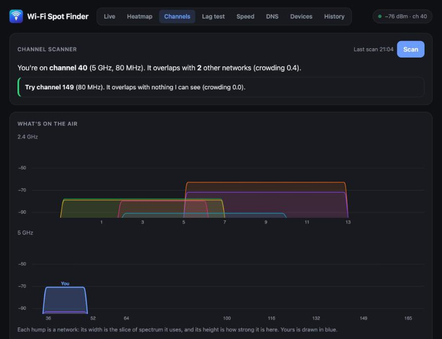

# Wi-Fi Spot Finder

A small macOS app for figuring out where the Wi-Fi in your place is actually good.

It started as a way to walk around with the laptop and watch the signal number change. Then I wanted to know where a mesh node would help, why the connection got laggy whenever something was uploading, whether I was getting the speed I pay for... and it kept going from there.

## What's in it

Everything is in one window, plus a menu bar icon that shows the current signal.

- **Live**: signal in dBm, ping to the router and to 1.1.1.1, and a beep mode that speeds up as the signal improves, so you can walk around without staring at the screen.
- **Heatmap**: load a floor plan (a phone photo of a sketch works), click where you're standing and record for 10 seconds. After a few rooms you get a rough coverage map, the dead zones, and a guess at where a mesh node or extender would help most.
- **Channels**: scans the networks around you and tells you if your router is sharing its channel with the neighbours, and which one is quieter.
- **Lag test**: measures how much latency goes up when the line is busy (bufferbloat) and gives you QoS numbers to try on the router.
- **Speed**: occasional speed tests compared with what your plan says you should get. Off by default, since each one uses about 100 MB.
- **DNS**: times your current DNS against your router and a few public resolvers.
- **Devices**: what's connected to your network, who made it (when that can be worked out), and a notification when something new shows up.
- **History**: a background log of signal and ping, with dropouts sorted into "Wi-Fi dropped", "router stopped answering" and "internet was down". Exports to CSV if you need to argue with your ISP.

<p>
  
  
</p>
<p>
  
  
</p>

## Running it

You'll need macOS 13 or newer, the Xcode command line tools (`xcode-select --install`) and Python 3.

```sh
git clone https://github.com/Ilakiancs/wifi-spot-finder.git
cd wifi-spot-finder
./build-app.sh
```

That builds the app and puts it in `/Applications`. Add `--no-install` if you only want it built into `build/`. You can also skip the app entirely: `python3 server.py` serves the same pages at http://localhost:8765.

macOS will ask for a couple of permissions along the way. Local network access is needed to ping the router and find devices. Notifications are only used for the new device alert. Location is optional: macOS hides the names of nearby networks from apps without it, so the Channels tab only asks if you click "Show network names". Channel numbers work fine without it, and the app never reads your actual location.

## How it works

Browsers can't see Wi-Fi signal strength, so `wifisampler.swift` asks CoreWLAN for it twice a second (and runs the network scans). `server.py` runs that, pings the router and 1.1.1.1, logs a line every 10 seconds and serves the pages in `web/`. The heavier parts (channel scoring, speed checks, device discovery, the DNS test) are in `tools/`. `app/main.swift` wraps it all into a Mac app with a window and the menu bar icon.

Data stays in `~/Library/Application Support/Wi-Fi Spot Finder/`, and logs are kept for 30 days. The things that do go over the internet are the pings, Apple's `networkQuality` tests, the DNS test queries, and a one-time download of the IEEE's list of hardware makers (about 4 MB).

Some details on how the numbers are worked out:

- Signal: -55 dBm or better is great, -65 is fine, around -72 starts getting iffy, and below -80 is unreliable.
- The lag grade uses the usual bufferbloat scale for added delay: A+ under 5 ms, A under 30, B under 60, C under 200, D under 400, F beyond that. It takes the worse of my own ping to 1.1.1.1 and Apple's latency probes during the load, because ping on its own often looks fine on connections where video calls clearly aren't.
- Channel crowding adds up every network that overlaps a channel, with strong ones counting more than faint ones. Extra names broadcast by your own router (a guest network, say) don't count against you.
- Speed results that come close to what your Wi-Fi link can carry are marked as limited by Wi-Fi and left out of the averages, since they say more about your signal than about your ISP.
- Dropouts shorter than 3 seconds are ignored.

## Limitations

- macOS only.
- macOS refreshes the signal about once a second, so give it a moment at each spot.
- The heatmap is interpolated between the points you record. More points, better map.
- History, scheduled speed checks and device alerts only run while the app is open. Turn on "Launch at Login" from the menu bar if you want it running all the time.
- Phones and newer laptops use private hardware addresses, so their maker shows as unknown, and some change address now and then and turn up as new devices.
- Without Location access, the scanner can't be completely sure which nearby networks belong to your own router, so it guesses from signal strength.

## License

MIT
