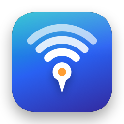

<p align="center"></p>

<h1 align="center">Wi-Fi Spot Finder</h1>

<p align="center">Find the best Wi-Fi spot at home, map your coverage, catch dropouts, and fix lag. A small macOS app.</p>

---

## What it does

| Tab | What you get |
|---|---|
| **Live** | Real-time signal gauge (dBm), a "getting better / worse" arrow, a Geiger-counter beep mode, SNR, link rate, router and internet ping, and 10-second spot recordings ranked by score |
| **Heatmap** | Upload a floor plan (photo, sketch or screenshot) or use a blank grid, then click where you stand and record. Shows a coverage heatmap, dead zones, the best spot, and **where to put a mesh node or extender** |
| **Lag test** | Bufferbloat test graded **A+ to F**: how much delay builds up while the line is busy downloading or uploading. Gives exact **router QoS limits** to fix it, and compares against past runs |
| **History** | Background log of signal, router ping and internet ping, with dropouts classified as Wi-Fi, router or **ISP**, plus a CSV outage report you can send your provider |

Plus a **menu bar icon** that colours with signal strength and shows today's summary (average signal, dropouts, downtime). Closing the window keeps monitoring running; **Launch at Login** makes it 24/7.

## Requirements

- macOS 13+
- Xcode Command Line Tools (`xcode-select --install`) for `swiftc`
- Python 3 (`brew install python`)

## Install / run

**Mac app** (menu bar + own window):

```sh
./build-app.sh
```

This builds `Wi-Fi Spot Finder.app` and installs it into `/Applications`. Quit from the menu bar icon.

**Without the app** (opens in your browser):

```sh
python3 server.py        # then open http://localhost:8765
```

If macOS asks to let the app find devices on your local network, click **Allow**. It needs this to ping your router.

## How it works

| Path | Role |
|---|---|
| `wifisampler.swift` | Reads RSSI, noise, link rate and channel from CoreWLAN; prints one JSON line per sample |
| `server.py` | Runs the sampler plus pings to the router and 1.1.1.1, logs history every 10 s, detects dropouts, runs lag tests via Apple's `networkQuality`, and serves the pages |
| `web/` | Dashboard pages (vanilla JS, no dependencies): `index.html`, `heatmap.html`, `lag.html`, `history.html` |
| `app/main.swift` | Native wrapper: menu bar item, WebKit window, downloads, file picker, launch-at-login agent |
| `app/icon.swift` | Draws the app icon |
| `build-app.sh` | Compiles everything into a `.app` bundle |

Browsers can't read Wi-Fi signal strength, which is why a local helper is needed. The server only listens on `127.0.0.1`, and nothing is sent anywhere except the pings and Apple's speed test.

### Dropout classification

Every second the monitor checks, in order:

1. **Wi-Fi disconnected**: the Mac has no Wi-Fi association
2. **Router unreachable**: connected, but no reply from the router for 4 s
3. **Internet down**: the router answers, but 1.1.1.1 doesn't for 4 s, so it's on the ISP side

Blips shorter than 3 s are ignored.

### Lag grading

Lag is measured two ways during Apple's `networkQuality` load test: ICMP ping to 1.1.1.1, and Apple's latency probes on separate connections while the line is loaded. Those probes behave like a video call. Each direction is graded on the worse of the two:

| Added delay | < 5 ms | < 30 | < 60 | < 200 | < 400 | ≥ 400 |
|---|---|---|---|---|---|---|
| Grade | A+ | A | B | C | D | F |

### Data

Everything is stored in `~/Library/Application Support/Wi-Fi Spot Finder/`: spots, floor plan, lag-test history, dropout events, and daily logs (kept for 30 days). Use **Open Data Folder** in the menu bar to find it.

## Reading the numbers

| Signal | Quality |
|---|---|
| −55 dBm or better | Excellent |
| −65 dBm | Good |
| −72 dBm | Fair |
| −80 dBm or worse | Unreliable |

A signal-to-noise ratio of 25 dB or more is good. A router ping should normally be a steady 1–5 ms.
