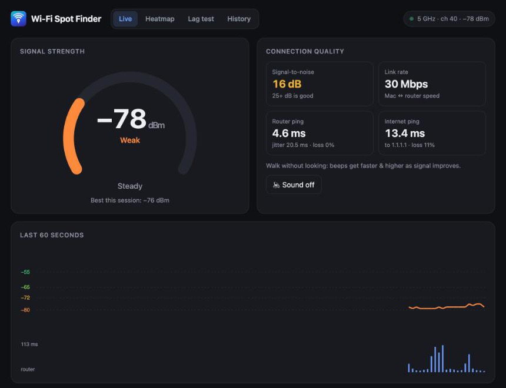
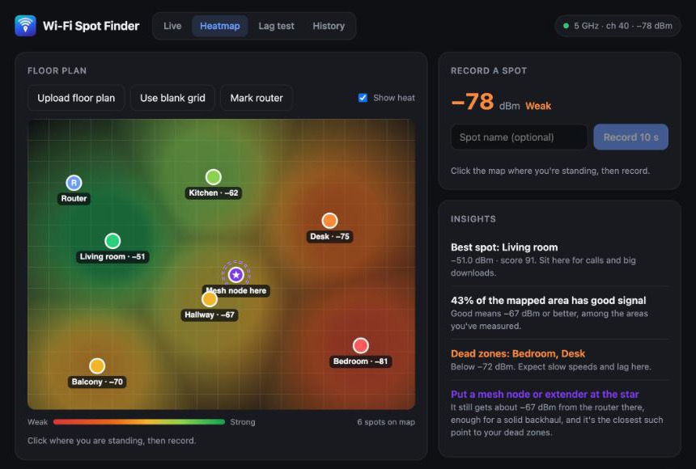
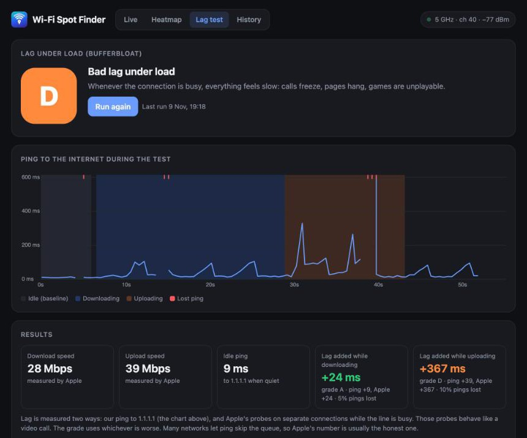

# Wi-Fi Spot Finder

A small macOS app for figuring out where the Wi-Fi in your place is actually good.

It started as a quick way to walk around with the laptop and watch the signal number change, and then kept growing. Right now it does four things:

- **Live** shows the signal in dBm, ping to your router and to 1.1.1.1, and has a beep mode (faster beeps = better signal) so you don't have to stare at the screen while walking around.
- **Heatmap** lets you drop in a floor plan (a phone photo of a sketch is fine), click where you're standing and record for 10 seconds. After a few rooms you get a rough coverage map, your dead zones, and a suggestion for where a mesh node or extender would help.
- **Lag test** checks how much your latency goes up when the connection is busy (bufferbloat). If it's bad, it tells you what QoS limits to try on your router.
- **History** logs in the background and keeps track of dropouts, split into "Wi-Fi dropped", "router stopped answering" and "internet was down". You can export the outages as a CSV if you need to show your ISP.

There's also a menu bar icon with the current signal and a short summary for the day.

<p>
  
  
</p>


## Running it

You need macOS 13 or newer, the Xcode command line tools (`xcode-select --install`) and Python 3.

```sh
git clone https://github.com/Ilakiancs/wifi-spot-finder.git
cd wifi-spot-finder
./build-app.sh
```

That builds the app and copies it into `/Applications`. If you don't want the app, `python3 server.py` works too and opens the same pages in your browser at http://localhost:8765.

The first time it runs, macOS may ask whether it can find devices on your local network. Say yes, it needs that to ping your router.

## How it works

Browsers can't read Wi-Fi signal strength, so there's a tiny Swift program (`wifisampler.swift`) that asks CoreWLAN for it twice a second. `server.py` runs that, pings the router and 1.1.1.1, writes a log line every 10 seconds, and serves the pages in `web/`. The Mac app (`app/main.swift`) is mostly a wrapper: it starts the server, shows the pages in a window and runs the menu bar icon.

Everything stays on your machine. Data lives in `~/Library/Application Support/Wi-Fi Spot Finder/` and logs are kept for 30 days.

Some notes on the numbers:

- Signal: around -55 dBm or better is great, -65 is fine, -72 is getting iffy, and below -80 things get unreliable.
- Lag grades use the usual bufferbloat scale based on how much delay gets added under load: A+ under 5 ms, A under 30, B under 60, C under 200, D under 400, F above that.
- The lag test runs Apple's `networkQuality` and grades on the worse of two numbers: my own ping to 1.1.1.1, and Apple's latency probes on separate connections during the test. Ping alone often looks fine on networks where video calls clearly aren't, so both are shown.
- A dropout only counts if it lasts at least 3 seconds.

## Limitations

- macOS only.
- macOS refreshes the signal reading about once a second, so pause for a moment at each spot.
- The heatmap is interpolated between the points you record, so more points means a better map. It fades out where you haven't measured.
- History only covers the time the app was running. Turn on "Launch at Login" from the menu bar icon if you want it running all the time.

## License

MIT
